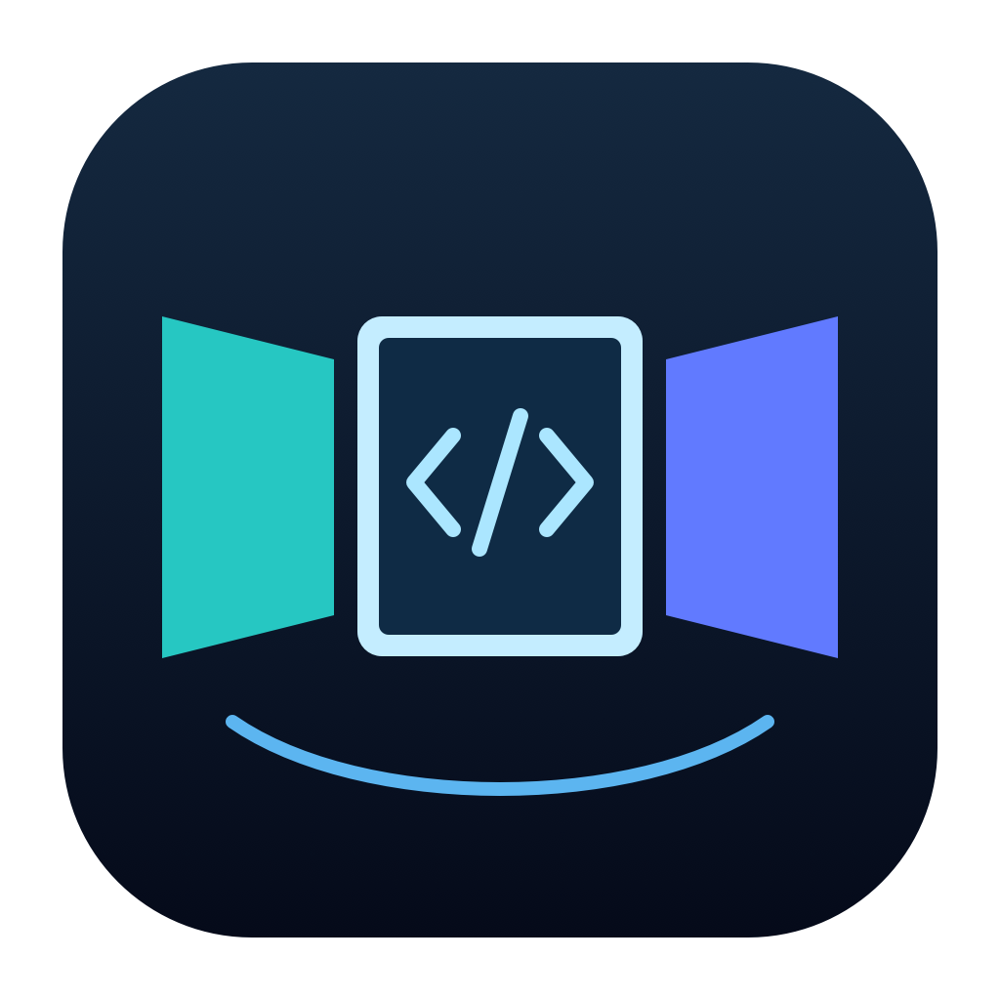

# RayNeo GT Mac Workspace



简体中文 | [English](README.md)

**为雷鸟 RayNeo GT 提供三个 macOS 虚拟桌面，支持转头查看和原生鼠标键盘操作。**

通过 USB-C 将雷鸟 GT 直连 Apple Silicon Mac，把浏览器、编辑器、终端等真实应用窗口放进三个独立桌面，再通过转头查看左、中、右工作区。

建议 GitHub 仓库名称：**`rayneo-gt-mac-workspace`**。

## 功能

- 三个独立的 1920 × 1080 macOS 虚拟显示器，可放真实应用窗口。
- 基于陀螺仪的头部追踪、启动校准和一键回中。
- 原生鼠标跨屏、键盘输入、滚动和窗口拖拽。
- 可调整屏幕大小、距离、间距、转头轴和方向。
- 可选捕获/渲染帧率，以及 Metal 和 Core Image 纹理路径。
- 设置保存、本地状态诊断和显示器布局恢复。
- 点击 Dock 图标、菜单栏入口或应用菜单 **⌘0**，重新显示控制面板。
- 可选 **⌘⌥1 / 2 / 3** 移动选中的应用窗口，**⌘⌥0** 移回 Mac。

## 兼容性与版本状态

| 项目 | 要求 |
| --- | --- |
| Mac | Apple Silicon / arm64；已测试 M2，尚未实测 M4 |
| macOS | 26.0 或以上 |
| 眼镜 | 雷鸟 RayNeo GT，以支持视频的 USB-C 线直连 |
| 眼镜模式 | 跟随模式 |
| 编译工具 | 带 macOS 26+ SDK 和 Swift 编译器的 Xcode Command Line Tools 或 Xcode |

当前实测环境为 **M2 MacBook Air + macOS 26.6.2 + 雷鸟 GT**。M4 属于支持的 arm64 架构，但完整设备组合尚未实测。其他眼镜型号尚未验证。

**当前版本：0.10.1 开发试用版。** 本轮修复后，用户已确认三屏观看、转头追踪和 Dock 重开控制面板正常。长期运行、拔插与睡眠唤醒还需要更广泛的测试。原 **v0.8** 基线保留在 Git 中。

项目使用私有 `CGVirtualDisplay` 接口，macOS 更新可能影响兼容性。姿态通过陀螺仪积分获得，长时间使用可能需要回中。

## 构建与运行

下载并解压源码，或克隆自己的仓库，在项目文件夹打开终端。

```sh
git clone https://github.com/poppinyunhai/rayneo-gt-mac-workspace.git
cd rayneo-gt-mac-workspace
```

没有编译工具时先运行：

```sh
xcode-select --install
```

首次本地体验可使用临时签名构建：

```sh
SIGNING_IDENTITY=- bash build.sh
open build/dev/RayNeoWorkspace-Dev.app
```

应用生成在 `build/dev/RayNeoWorkspace-Dev.app`。独立源码体验 ZIP 还包含可双击的 `构建体验版.command`。

长期开发建议按[签名说明](docs/SIGNING.md)配置自己的固定身份，不需要原作者的证书或私钥。重新构建或更换签名身份可能需要再次授权屏幕录制权限。

## 第一次体验

1. 退出其他 RayNeo Workspace 版本，GT 直连 Mac，并切换到**跟随模式**。当前实测环境未连接其他实体外屏。
2. 打开应用，点击**启动三屏**。
3. 在“系统设置 → 隐私与安全性 → 屏幕与系统音频录制”允许该应用。若系统要求，退出重开后再次启动。应用不捕获音频。
4. 让眼镜保持静止约 **3 秒**，等控制面板出现**姿态追踪**，再左右转头查看。正前方通常是中间桌面。
5. 鼠标从 Mac 右边缘依次进入左、中、右桌面，可正常输入、滚动和拖拽窗口。
6. 朝向偏移时点击**回中**；使用**停止三屏**移除虚拟屏并恢复布局；用**退出**或 **⌘Q** 退出。

普通鼠标键盘操作不需要辅助功能权限；可选窗口移动按钮和快捷键需要该权限。

## 常见问题

| 现象 | 检查方法 |
| --- | --- |
| 转头后仍只看到中间桌面 | 等待校准完成，检查 GT 跟随模式以及转头轴/方向；控制面板会显示追踪状态和角度。 |
| 黑屏或捕获失败 | 检查屏幕录制权限，按提示退出重开；也可选择“兼容模式 · Core Image”，停止后重新启动。 |
| 控制面板被关闭或最小化 | 点击 Dock 图标、菜单栏“GT 三屏”，或在应用处于前台时按 ⌘0。 |
| 异常退出后布局没有恢复 | GT 连接时重新打开应用，点击“恢复布局”。 |

## 本地数据与隐私

屏幕内容在本机处理，用于眼镜画面显示。应用不保存录屏、不捕获音频、不上传屏幕内容，也不刷固件或写入永久设备校准。

本地数据保存在 `~/Library/Application Support/RayNeoWorkspace-Dev/`：

- `settings.json`：用户设置。
- `pending-layout.json`：用于布局恢复的原输出位置。
- `runtime-status.json`：会话、捕获、姿态、CPU 和内存状态，不含屏幕图片。

## 开发与测试

```sh
bash Tests/run-tests.sh
bash Tests/run-texture-test.sh
```

第一项检查核心逻辑和生命周期清理；第二项使用真实 Metal 设备进行离屏纹理测试。

采集本地性能数据：

```sh
python3 scripts/collect-metrics.py --duration 60
```

生成独立源码体验包：

```sh
python3 scripts/package-source.py
```

输出为 `build/exports/RayNeoWorkspace-v0.10.1-source-trial.zip`。

| 文档 | 内容 |
| --- | --- |
| [朋友体验说明](docs/FRIEND_TRIAL.md) | 构建、授权与体验步骤 |
| [工程结构](docs/ARCHITECTURE.md) | 组件和实现说明 |
| [测试清单](docs/TESTING.md) | 检查与实机验收状态 |
| [性能测量](docs/PERFORMANCE.md) | 帧率、诊断与漂移测量 |
| [签名说明](docs/SIGNING.md) | 固定本地签名配置 |

反馈问题时，请提供 Mac 型号、macOS 版本、GT 型号、复现步骤和控制面板状态。分享截图或诊断前，请移除个人内容。

本项目是独立社区项目，并非雷鸟官方产品。
